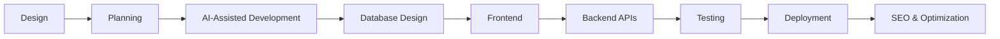

<h1 align="center">Hi 👋, I'm Tarun Mankar</h1>
<h3 align="center">Gen AI Content Developer | AI-Powered Full Stack Software Engineer | Next.js Developer</h3>

<p align="center">
  
</p>

---

### 🚀 About Me

I harness the power of **Artificial Intelligence** to build next-generation applications, stunning websites, engaging videos, compelling ads, and immersive music. My workflow combines software engineering with Generative AI, letting me rapidly **design, develop, deploy, and scale** complete digital products — from idea to production.

I specialize in **SaaS platforms**, **Android apps**, **AI automation systems**, and **commercial music licensing platforms**.

```txt
🎯 Focus:        Full Stack Web & Mobile Dev, AI-Assisted Engineering
🎵 Side Quest:   Running Tarun Music — a licensed AI music catalog (346+ tracks)
📚 Also Do:      AI-narrated audiobooks & self-published e-books
💬 Ask Me About: Next.js, React Native, Supabase, Prompt Engineering
⚡ Fun Fact:     I ship products from idea to production with AI as my co-pilot
```

---

### 🛠 What I Create with AI

<table>
<tr>
<td valign="top" width="50%">

- 🌐 **Apps & Websites** — smart, responsive, AI-powered web & mobile apps
- 🎬 **Videos & Ads** — generative AI video content and advertisements
- 🎨 **Images & Art** — visuals and graphics with state-of-the-art AI models
- 🎵 **Music & BGM** — original tracks and cinematic background scores

</td>
<td valign="top" width="50%">

- ☁️ Scalable SaaS Platforms
- 📱 Android App Development
- ✍️ AI Content Creation & Prompt Engineering
- 📈 Advanced SEO & Performance Optimization

</td>
</tr>
</table>

---

### 💻 Tech Stack

<p align="center">
  
</p>

<details>
<summary><b>📂 Detailed Breakdown</b></summary>
<br>

**Frontend:** Next.js · React · React Native · JavaScript (ES6+) · TypeScript · HTML5 · CSS3 · Tailwind CSS · Bootstrap

**Backend:** Next.js API Routes · Node.js · REST APIs · JWT · OAuth · Server Actions

**Databases:** PostgreSQL · Neon · Supabase · Firebase Firestore · Firebase Realtime DB · SQLite

**Cloud & Deployment:** Vercel · Cloudflare · Cloudflare R2 · AWS S3 · CDN Configuration · GitHub Pages · DNS & SSL

**AI Tools:** Cursor AI · AntiGravity IDE · ChatGPT · Claude · Gemini · GitHub Copilot · ElevenLabs

**DevOps:** Git · GitHub · GitHub Actions · Environment Variables · CI/CD (Vercel)

</details>

---

### 🌟 Featured Projects

| Project | Description |
|---|---|
| 🎵 [**Tarun Music**](https://tarunmusic.co.in/) | Premium cinematic background scores, trailer music & custom compositions — 346+ licensed tracks for creators, brands & filmmakers |
| 🧮 [**CalcifyHub**](https://calcifyhub.in/) | A comprehensive web application offering various calculation tools |
| 📚 [**AI Gyani**](https://aigyani.in/) | An educational platform and blog dedicated to Artificial Intelligence and Machine Learning |
| 📰 [**Jordar Khabar**](https://jordarkhabar.in/) | A dynamic news platform delivering the latest updates and stories |
| 🧭 [**Gen-AI Orchestrator**](https://aiorchestrator.xyz/) | Master AI software development with 50+ niche blueprints and startup roadmaps |
| 🔌 [**Wings Telecom**](https://wings-telecom.com/) | Integrated telecom and energy solutions — equipment installation and solar power services |
| 💸 [**SplitBhai**](https://tarunmankar.github.io/splitbhai/index.html) | Android app for easy expense sharing and management |
| 🏦 [**SmartEMI**](https://tarunmankar.github.io/smartemi/index.html) | Calculate Loan EMI, interest & compare loans with a sleek premium design |
| 📊 [**ReturnX**](https://tarunmankar.github.io/returnx/index.html) | Smart Return Calculator for every Indian investor — SIP, EMI, FD, PPF & more |

---

### 🎵 Tarun Music — Highlights

<p align="center">
  
  
  
</p>

Verified AI Music Creator on **ElevenLabs**, offering cinematic BGM, trailer music, film scores, game music, and brand/ad music under Social Media, Paid Marketing, and Offline & Venue licenses. Listen on [Spotify](https://open.spotify.com/artist/70FV2z16ZGCIkiThvqYJVe), [Apple Music](https://music.apple.com/in/artist/tarun-music/1887960964), or the [ElevenLabs Marketplace](https://elevenlabs.io/app/music/explore/creator/LfAdKsiGjPdvt8Qcs1o6).

---

### 🎬 AI Video Creations

A showcase of AI visual storytelling on [YouTube](https://www.youtube.com/@tarun_mankar) — concept trailers, mythology short films, disaster documentaries, and horror stories, including *Mumbai Ka Don*, *The Lost Temple of Naga*, *Bhopal Gas Tragedy 1984*, and *Kedarnath Disaster 2013*.

---

### 📚 Audiobooks & E-Books

- 🎧 AI-narrated audiobooks on **ElevenReader** — *Stop Spiraling*, *Healing the Scarcity Mindset*, *Somatic Pacing*
- 📖 Self-published e-books on **Amazon** — Instagram growth guide, online earning ideas, blogging mastery

---

### 🛠 My Development Workflow



---

### 📊 GitHub Stats

<p align="center">
  
  
</p>

<p align="center">
  
</p>

---

### 🏆 Badges

[](https://holopin.io/@tarunmankar)

---

### 💡 My Strength

> I don't just write code.

I design, build, deploy, optimize, and scale complete AI-powered digital products — from idea to production.

---

<p align="center">
  <i>⭐️ From <a href="https://tarunmankar.github.io">Tarun Mankar</a> — Gen AI Content Developer | Full Stack Engineer | Next.js Specialist | SaaS Builder</i>
</p>
